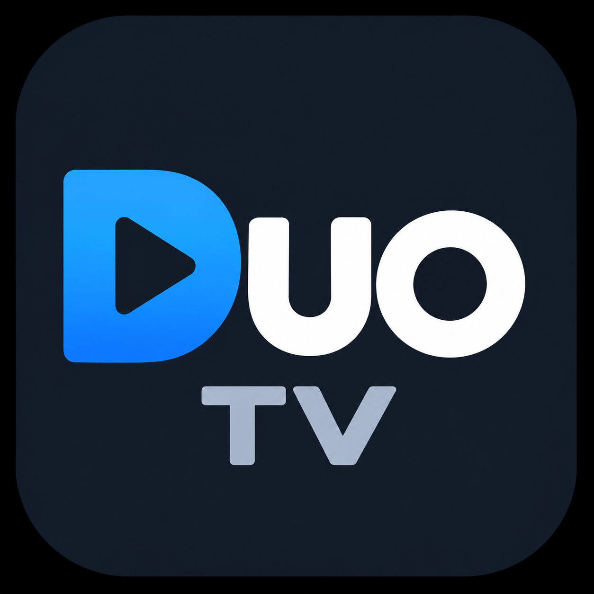

<p align="center">
  
</p>

<h1 align="center">Duo Launcher</h1>

<p align="center"><strong>A calmer, more personal home for your TV.</strong><br />Your photos, your apps, and live TV—together in one remote-friendly space.</p>

<p align="center">
  
  
  
</p>

## ✨ Make the big screen yours

<table>
  <tr>
    <td width="50%"><strong>🌅 A home with a little life</strong><br />Dynamic, laid-back greetings meet a clear clock and date over a photo-forward backdrop.</td>
    <td width="50%"><strong>🖼️ Your photos, front and center</strong><br />Use a wallpaper, cycle a photo folder, or bring in a public Google Photos album.</td>
  </tr>
  <tr>
    <td width="50%"><strong>📺 Live TV, neatly organized</strong><br />Browse IPTV channels by category, with guide data, logos, and controls for the channels you want to see.</td>
    <td width="50%"><strong>▶️ Settle into the show</strong><br />See current-program progress, change channels with Up/Down, and prefer Hindi audio when a stream offers it.</td>
  </tr>
  <tr>
    <td width="50%"><strong>📱 Your apps, your order</strong><br />Choose and arrange home shortcuts, with quick access to Wi-Fi, Android settings, and Duo settings.</td>
    <td width="50%"><strong>🎮 Made for the remote</strong><br />TV-friendly focus states and an optional Accessibility-based Home button override help Duo feel at home on your device.</td>
  </tr>
  <tr>
    <td colspan="2"><strong>🔐 Flexible playback</strong><br />Configure global or per-channel Widevine license URLs and request headers. Stream, DRM, and codec support depends on the TV.</td>
  </tr>
</table>

## 🛠️ Build from source

Open the project in Android Studio, or run:

```sh
./gradlew assembleDebug
```

The debug APK is written to `app/build/outputs/apk/debug/app-debug.apk`. The project targets Android 15 and supports Android 8.0 (API 26) and newer. Android Studio may ask you to select your Android SDK.

## 🚀 Set up your space

After installing, choose Duo Launcher as the device's Home app. If the TV keeps opening its built-in launcher, open Duo's **Home button** settings and enable the Duo Accessibility service from Android's Accessibility settings.

Open Duo's full-screen **Settings** page to personalize the launcher:

- **Live TV:** Enter an M3U/M3U8 playlist URL and optional XMLTV URL. Plain `.xml` and gzip-compressed `.xml.gz` guides are supported; guide entries match channels by `tvg-id`. Playlist and guide refresh on startup, and **Refresh now** requests an immediate update. Cached channels stay visible during refresh.
- **Apps & Clock:** Choose and reorder shortcuts. If no custom list is saved, Duo shows up to eight installed apps. Set 12/24-hour time and toggle the date.
- **Appearance:** Choose a single wallpaper, a photo folder, or a Google Photos public album link. Folder and album photos cycle every five seconds; albums must be shared with anyone who has the link. The photo backdrop covers 70% of the screen, with app tiles along its lower edge.
- **Channels:** Browse horizontal rows grouped by M3U `group-title`. Logos load from `tvg-logo` values and cache in memory and on disk. Use **Manage hidden channels** to search, hide, or restore channels.

## 🎬 Playback & guide

During playback, Up/Down changes channels and the current programme progress appears on screen. Use Back to return to Duo.

For Widevine channels, set a global license URL and optional request headers in Settings, or add per-channel Kodi `KODIPROP` license tags to the M3U. Channel values override global settings. Playback uses Media3 ExoPlayer; supported DRM schemes, packaging, and codecs depend on the TV.

Per-channel tags follow Kodi's common form. URL-encode license request headers:

```m3u
#EXTINF:-1 tvg-id="channel.one" tvg-logo="https://img.example/logo.png" group-title="News",Channel One
#KODIPROP:inputstream.adaptive.license_type=com.widevine.alpha
#KODIPROP:inputstream.adaptive.license_key=https://license.example/widevine|Authorization=Bearer%20token&Origin=tv.example|R{SSM}|
https://stream.example/channel/manifest.mpd
```

Widevine playback supports DASH and FMP4/CMAF HLS when the TV supports the stream's DRM and codecs.
