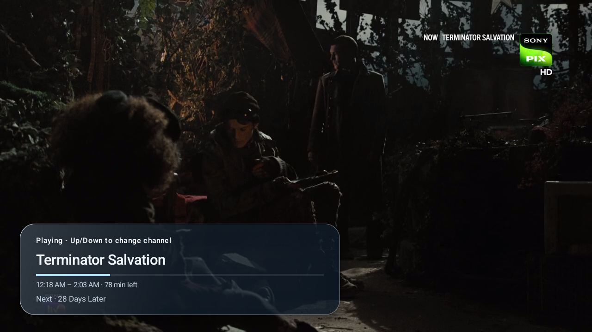
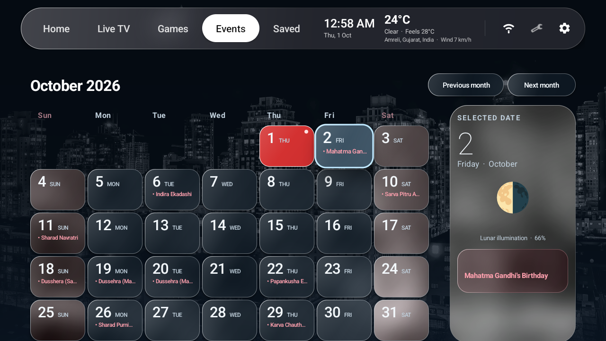
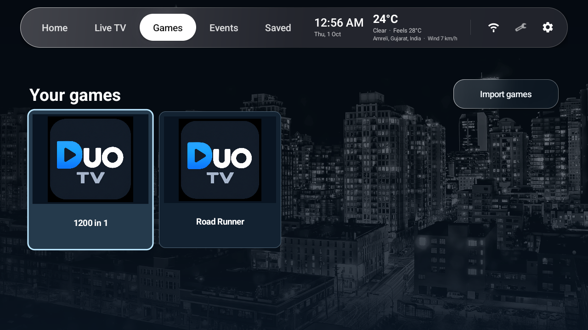
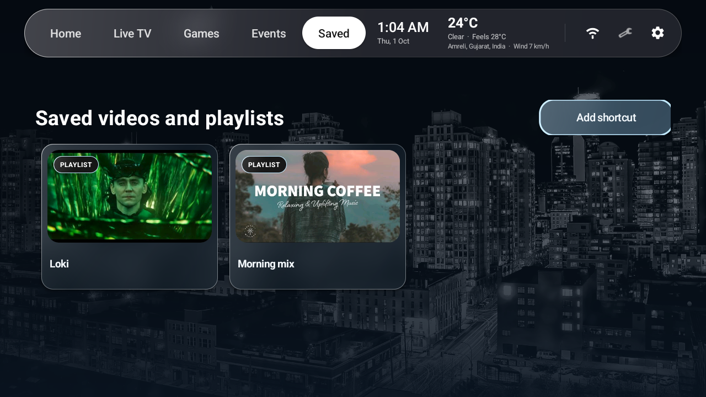

<p align="center">
  
</p>

<h1 align="center">Sva Launcher</h1>

<p align="center">
  <strong>A calm, personal home screen for Android TV.</strong><br />
  Bring apps, live TV, games, calendars, saved videos, weather, and your own photos together in one remote-first interface.
</p>

<p align="center">
  
  
  
</p>

<p align="center">
  <a href="#screenshots">Screenshots</a> ·
  <a href="#features">Features</a> ·
  <a href="#getting-started">Getting started</a> ·
  <a href="#build-from-source">Build from source</a> ·
  <a href="#contributing">Contributing</a>
</p>

> Sva is a launcher and media front end. It does not provide TV channels, programme data, ROMs, BIOS files, game artwork, or paid-media credentials. Bring content that you are legally allowed to use.


<p align="center">
  <strong>Launcher that does all and still ultra fast and opensource!</strong><br/>
  Home screen with your google photos memories, IPTV directly integrated in launcher with old cabel TV vibe! Reminders of your fav events, Gaming and many more things. 
</p>

## Screenshots

<table>
  <tr>
    <td width="50%" align="center"><br /><sub><strong>Home</strong> — apps and useful information at a glance</sub></td>
    <td width="50%" align="center"><br /><sub><strong>Live TV</strong> — categories, channel logos, and now/next data</sub></td>
  </tr>
  <tr>
    <td width="50%" align="center"><br /><sub><strong>TV guide</strong> — current and upcoming programmes</sub></td>
    <td width="50%" align="center"><br /><sub><strong>Live TV</strong> — DRM supported with prev/next nevigation</sub></td>
  </tr>
  <tr><td width="50%" align="center"><br /><sub><strong>Events</strong> — a remote-friendly monthly calendar</sub></td>
   <td width="50%" align="center"><br /><sub><strong>Games</strong> — a local NES library powered by Nestopia UE</sub></td>
</tr>
<tr>
  <td width="50%" align="center"><br /><sub><strong>Games</strong> — install your own NES roms</sub></td>
<td width="50%" align="center"><br /><sub><strong>Saved</strong> — shortcuts to videos and playlists</sub></td>
  </tr>
</table>

## Features

- **Remote-first navigation** — focusing a top-level tab selects it immediately, with clear focus states throughout the UI.
- **Personal home screen** — select and reorder app shortcuts; keep the clock, date, weather, Wi-Fi, tools, and settings close by.
- **Photo backdrops** — use a single image, rotate a local folder, or connect a public Google Photos album.
- **Live TV and guide** — load M3U/M3U8 playlists and optional XMLTV or XMLTV.GZ data, browse `group-title` categories, display `tvg-logo` artwork, and hide unwanted channels.
- **Integrated playback** — watch with Media3 ExoPlayer, move between channels with Up/Down, view programme progress, prefer Hindi audio when available, and configure global or per-channel Widevine settings.
- **NES library** — import your own `.nes` files and launch them directly through the embedded Nestopia UE core, without a separate emulator menu.
- **Events calendar** — connect a public Google Calendar iCal feed, see today's events, browse 12 months in either direction, and view selected-day details and lunar illumination.
- **Saved videos** — create artwork-rich shortcuts for YouTube videos and playlists.
- **Weather** — current conditions and a three-day forecast from Open-Meteo, using a chosen city or optional approximate device location.
- **Configurable refresh schedules** — independently control updates for photos, playlists, programme data, calendars, and Google Photos.
- **Backup and restore** — export launcher preferences, app and channel choices, and IPTV/DRM configuration to JSON.
- **Home-button helper** — an optional Accessibility service can reopen Sva on TVs that insist on returning to the manufacturer's launcher.

Cached channels, guide data, calendar entries, weather, and artwork remain available where supported when the network is unavailable.

## Getting started

1. Build and install the APK, then open **Sva Launcher**.
2. When Android asks for a Home app, select Sva. You can change this later in Android settings.
3. Open the gear icon and configure only the sections you need:

   | Section | What to add |
   | --- | --- |
   | **Apps** | Choose and reorder installed app shortcuts. Without a saved selection, Sva shows up to eight apps. |
   | **Appearance** | Select a wallpaper, a local photo folder, or a public Google Photos album. |
   | **Live TV** | Add an M3U/M3U8 playlist URL and, optionally, an XMLTV or XMLTV.GZ guide URL. |
   | **Channels** | Search, hide, and restore channels from the loaded playlist. |
   | **YouTube** | Save video and playlist links as cards in the Saved tab. |
   | **Calendar** | Add a public Google Calendar iCal link for the Events tab. |
   | **Games** | Import `.nes` files and optionally remap connected gamepads. |
   | **Weather** | Search for a city or explicitly request approximate device location. |
   | **Schedules** | Set an independent refresh cadence for each network-backed source. |

If the TV continues to open its built-in launcher, go to **Settings → Home button**, open Android's Accessibility settings, and enable Sva's service. This helper is optional and can be disabled at any time.

## Live TV notes

Guide entries are matched to channels by `tvg-id`. Selecting a current programme starts playback; selecting an upcoming programme creates an in-app reminder five minutes before it begins. Reminders are shown only while Sva is open and do not create background notifications.

For Widevine streams, configure a default license URL and request headers under **Playback & DRM**, or use per-channel Kodi properties in the playlist. Per-channel values take precedence:

```m3u
#EXTM3U
#EXTINF:-1 tvg-id="channel.one" tvg-logo="https://img.example/logo.png" group-title="News",Channel One
#KODIPROP:inputstream.adaptive.license_type=com.widevine.alpha
#KODIPROP:inputstream.adaptive.license_key=https://license.example/widevine|Authorization=Bearer%20token&Origin=tv.example|R{SSM}|
https://stream.example/channel/manifest.mpd
```

Widevine playback supports DASH and FMP4/CMAF HLS when the device supports the stream's DRM scheme, packaging, and codecs.

## Game controls

| Input | Player one action |
| --- | --- |
| Remote arrows | D-pad |
| Remote OK | NES A |
| Hold remote OK | Start |
| Back | Resume, Restart, and Exit menu |

Standard Android gamepads are assigned automatically for up to two players and can be remapped under **Settings → Games**. Save data is kept in Sva's private app storage.

## Build from source

### Requirements

- Android Studio or a command-line Android SDK installation
- JDK 17
- Android SDK Platform 35
- Android NDK `28.2.13676358`

Clone and build the project:

```sh
git clone https://github.com/clay-36/Sva-launcher-iptv.git
cd Sva-launcher-iptv
./gradlew assembleDebug
```

The debug APK is created at `app/build/outputs/apk/debug/app-debug.apk`. Install it on a connected TV or emulator with:

```sh
adb install -r app/build/outputs/apk/debug/app-debug.apk
```

Run the JVM test suite with:

```sh
./gradlew testDebugUnitTest
```

The app targets Android 15 (API 35), supports Android 8.0 (API 26) and newer, and builds native libraries for `arm64-v8a`, `armeabi-v7a`, and `x86_64`. The pinned Nestopia source is included under `third_party/nestopia` so native builds do not download emulator source at build time.

## Privacy and security

- Location permission is optional and is requested only when you choose device-based weather setup or refresh. City search works without device location.
- Wallpapers, imported games, and cached data stay on the device.
- Public album, calendar, playlist, guide, weather, and YouTube metadata requests are made directly from the TV.
- Backup files can contain playlist URLs, DRM endpoints, and credentials. Store them privately.
- Only connect sources and open links that you trust. Stream, DRM, and codec compatibility depends on the TV.

## Contributing

Bug reports, feature proposals, documentation fixes, and pull requests are welcome.

1. Search the existing issues before opening a new one.
2. Keep each pull request focused on one change.
3. Run `./gradlew testDebugUnitTest` and `./gradlew assembleDebug` before submitting.
4. For UI changes, include before/after screenshots and verify remote/D-pad focus behavior on a 1280×720 screen.
5. Do not commit ROMs, credentials, private playlist URLs, or copyrighted artwork.

When reporting a bug, include the TV/device model, Android version, reproduction steps, and a sanitized sample playlist or feed when relevant.

## License

Sva Launcher and the distributed combination with Nestopia UE are licensed under [GPLv3](LICENSE). Nestopia remains GPL-2.0-or-later and its original notices are preserved. See [NOTICE](NOTICE) for third-party attribution.

Every distributed APK must provide access to its matching complete source revision, including the native build files and pinned emulator core source.
