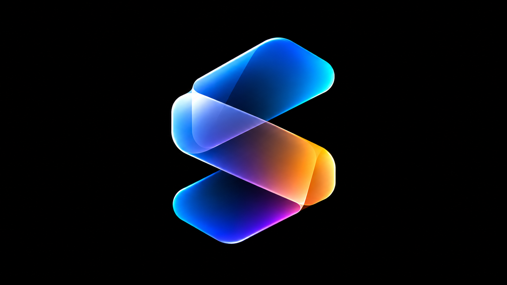
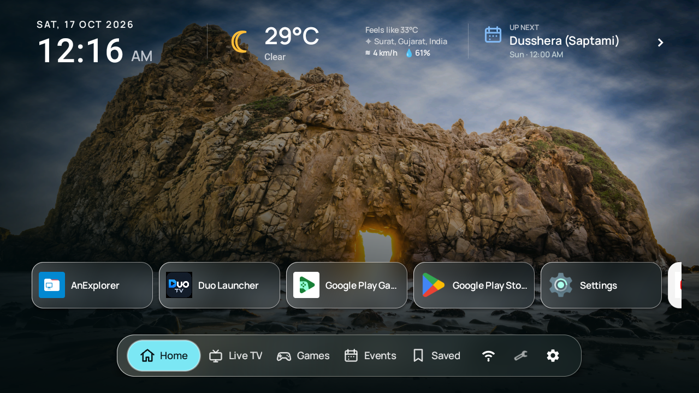
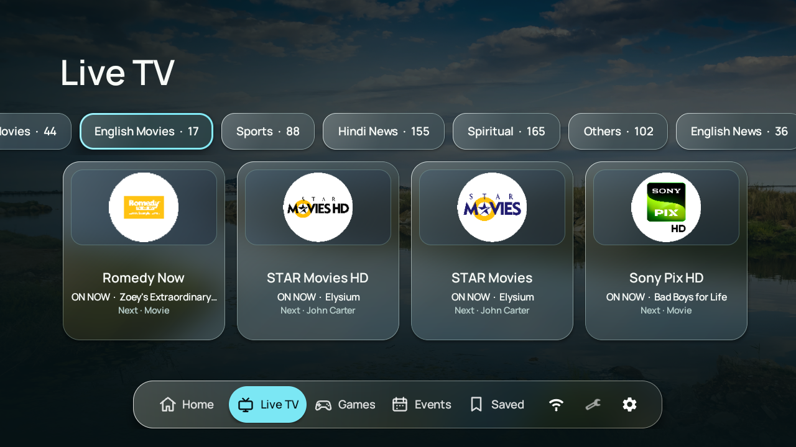
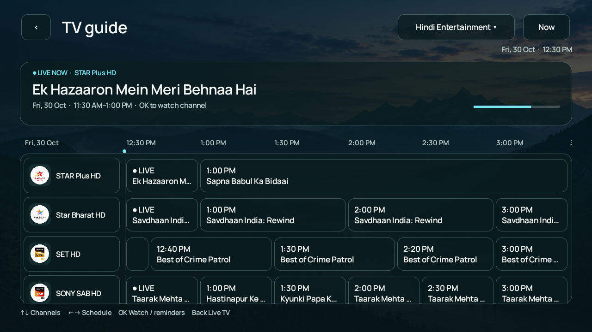
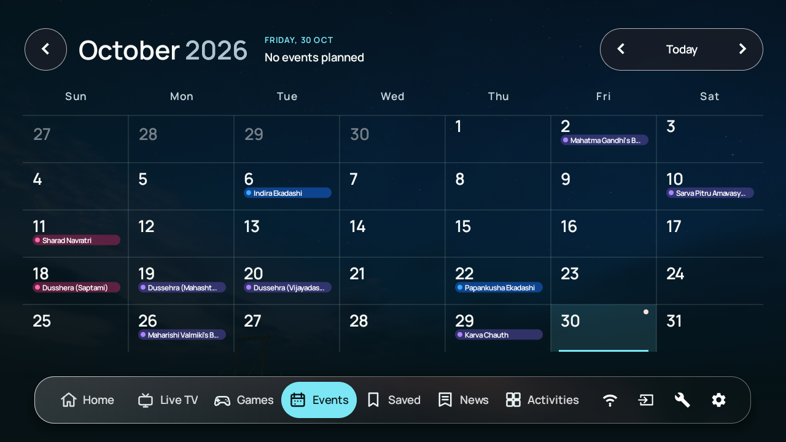
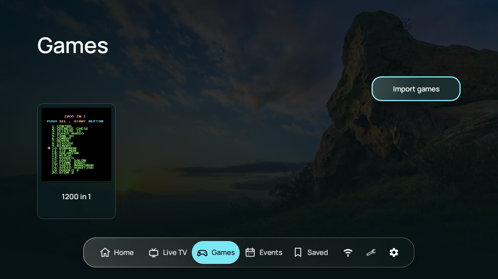
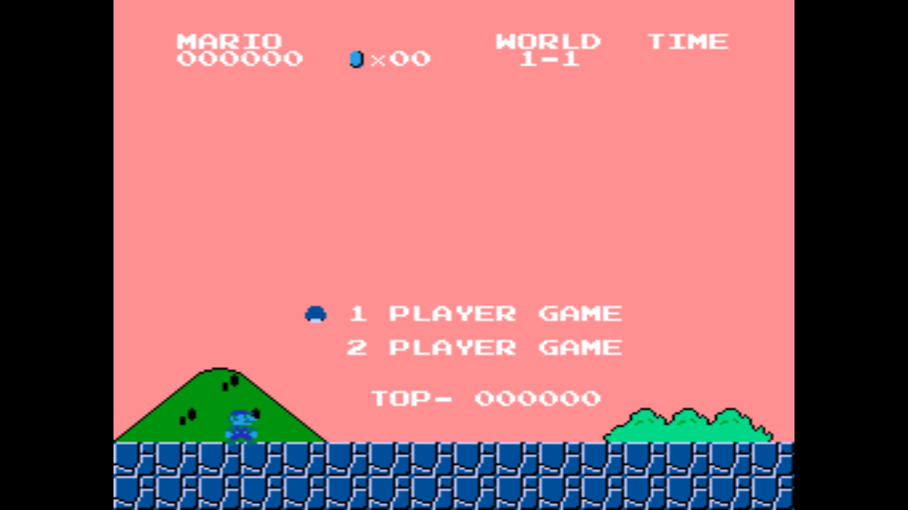
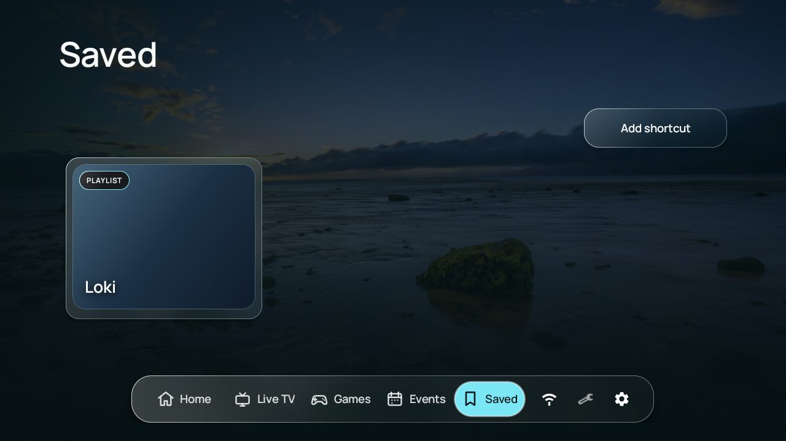

  

<h1 align="center">Sva Launcher</h1>

  <strong>A calm, personal home screen for Android TV.</strong> 
  Bring apps, live TV, games, calendars, saved videos, weather, and your own photos together in one remote-first interface.

  
  
  

  <a href="#screenshots">Screenshots</a> ·
  <a href="#features">Features</a> ·
  <a href="#installation">Installation</a> ·
  <a href="#getting-started">Getting started</a> ·
  <a href="DEVELOPER.md">Developer guide</a> ·
  <a href="#contributing">Contributing</a>

> Sva is a launcher and media front end. It does not provide TV channels, programme data, ROMs, BIOS files, game artwork, or paid-media credentials. Bring content that you are legally allowed to use.

https://github.com/user-attachments/assets/e70dc0ec-7901-41d4-bbc6-b21340dde9e8

## Screenshots

<table>
  <tr>
    <td width="50%" align="center"> <strong>Home</strong> — apps and useful information at a glance</td>
    <td width="50%" align="center"> <strong>Live TV</strong> — categories, channel logos, and now/next data</td>
  </tr>
  <tr>
    <td width="50%" align="center"> <strong>TV guide</strong> — current and upcoming programmes</td>
    <td width="50%" align="center"> <strong>Live TV</strong> — DRM supported with previous/next navigation</td>
  </tr>
  <tr><td width="50%" align="center"> <strong>Events</strong> — a remote-friendly monthly calendar</td>
   <td width="50%" align="center"> <strong>Games</strong> — a local NES library powered by Nestopia UE</td>
</tr>
<tr>
  <td width="50%" align="center"> <strong>Games</strong> — import your own NES ROMs</td>
<td width="50%" align="center"> <strong>Saved</strong> — shortcuts to videos and playlists</td>
  </tr>
</table>

## Features

- **Remote-first navigation** — focusing a top-level tab selects it immediately, with clear focus states throughout the UI. Settings dialog supports seamless two-way D-pad navigation between categories and controls without remote focus traps.
- **23 interface languages** (🇺🇸 🇬🇧 🇮🇳 🇪🇸 🇫🇷 🇸🇦 🇧🇷 🇨🇳 🇹🇼 🇩🇪 🇯🇵 🇰🇷 🇷🇺 🇮🇩 🇹🇷 🇧🇩 🇵🇰...) — follow the TV language or choose a language under **Settings → System → Language**, with refined offline translations and right-to-left layouts for Arabic and Urdu.
- **Personal home screen** — select and reorder app shortcuts; keep the clock, date, weather, Wi-Fi, tools, and settings close by.
- **Photo backdrops & dynamic contrast** — use a single image, rotate a local folder, or connect a public Google Photos album. Per-region luminance analysis dynamically adapts header widget text, accents, and drop shadows for optimal contrast over any wallpaper.
- **Fast, lightweight performance** — lazy tab loading, bounded view recycling for games, saved videos, and file browsing, and non-intrusive task progress indicators that reserve layout space without stealing remote focus.
- **Live TV and guide** — combine multiple M3U/M3U8 playlists and XMLTV, XMLTV.GZ, or JSON programme guides, browse `group-title` categories, display `tvg-logo` artwork, and hide unwanted channels.
- **Integrated playback** — watch with Media3 ExoPlayer, move between channels with Up/Down, view programme progress, prefer Hindi audio when available, and configure global or per-channel Widevine settings.
- **NES library** — import your own `.nes` files and launch them directly through the embedded Nestopia UE core, without a separate emulator menu.
- **Events calendar** — combine iCalendar feeds from Google Calendar, other providers, or local servers, see today's events, browse 12 months in either direction, and view selected-day details and lunar illumination.
- **Saved videos** — create artwork-rich shortcuts for YouTube videos and playlists, with remote actions to edit title, artwork, or remove cards directly from settings.
- **Weather** — current conditions and a three-day forecast from Open-Meteo, using a chosen city or optional approximate device location.
- **Configurable refresh schedules** — independently control updates for photos, playlists, programme data, calendars, and Google Photos.
- **Backup and restore** — export launcher preferences, app and channel choices, and IPTV/DRM configuration to JSON.
- **TV file browser** — browse internal storage and USB drives with the remote when adding games, choosing images or photo folders, and saving or restoring backups.
- **Home-button helper** — an optional Accessibility service can reopen Sva on TVs that insist on returning to the manufacturer's launcher.

Cached channels, guide data, calendar entries, weather, and artwork remain available where supported when the network is unavailable.

## Installation

Install Sva Launcher on your Android TV through the Google Play testing programme:

1. Join the [Sva Launcher Google Group](https://groups.google.com/g/sva-launcher).
2. Open the [Google Play testing page](https://play.google.com/apps/testing/com.sva.launcher) and join the testing programme.
3. Follow the Google Play link on that page to install **Sva Launcher** on your Android TV.

Use the same Google account to join the group, join the testing programme, and
install the app on your TV. Join the group before opening the testing page.

You can also [build and install the APK from source](DEVELOPER.md).

## Getting started

1. Follow the [installation guide](#installation), then open **Sva Launcher**.
2. When Android asks for a Home app, select Sva. You can change this later in Android settings.
3. Open the gear icon and configure only the sections you need:

   | Section | What to add |
   | --- | --- |
   | **Apps** | Choose and reorder installed app shortcuts. Without a saved selection, Sva shows up to eight apps. |
   | **Appearance** | Select a wallpaper, a local photo folder, or a public Google Photos album. |
   | **Live TV** | Add one or more M3U/M3U8 playlist URLs and optional XMLTV, XMLTV.GZ, or JSON guide URLs, one per line. |
   | **Channels** | Search, hide, and restore channels from the loaded playlist. |
   | **YouTube** | Save video and playlist links as cards in the Saved tab. |
   | **Calendar** | Add iCalendar feed URLs, one per line, for the Events tab. |
   | **Games** | Import `.nes` files and optionally remap connected gamepads. |
   | **Weather** | Search for a city or explicitly request approximate device location. |
   | **Schedules** | Set an independent refresh cadence for each network-backed source. |
   | **Navigation** | Show or hide Live TV, Games, and Events; choose the order of Live TV, Games, Events, and Saved. Home stays first, and hidden categories keep their place. |
   | **Language** | Follow the TV language or choose a different language for Sva. The choice also applies to Sva Memories. |

Calendar feeds must be readable without signing in. HTTPS and `webcal://` links are supported; HTTP is allowed for local/private hosts only (public HTTP links are upgraded to HTTPS). Duplicate feed URLs are ignored. If a feed cannot refresh, its previously cached events remain available while other feeds update. Calendar recurrence support covers common rules rather than every provider extension.

Supported interface languages (23):

| Flag | Language | Native Name | Code | Flag | Language | Native Name | Code |
| :---: | :--- | :--- | :---: | :---: | :--- | :--- | :---: |
| 🇺🇸 / 🇬🇧 | English | English | `en` | 🇷🇺 | Russian | Русский | `ru` |
| 🇮🇳 | Hindi | हिन्दी | `hi` | 🇮🇩 | Indonesian | Bahasa Indonesia | `id` |
| 🇪🇸 | Spanish | Español | `es` | 🇹🇷 | Turkish | Türkçe | `tr` |
| 🇫🇷 | French | Français | `fr` | 🇧🇩 | Bengali | বাংলা | `bn` |
| 🇸🇦 | Arabic | العربية | `ar` | 🇵🇰 | Urdu | اردو | `ur` |
| 🇧🇷 | Portuguese | Português | `pt` | 🇮🇳 | Tamil | தமிழ் | `ta` |
| 🇨🇳 | Chinese (Simplified) | 简体中文 | `zh-Hans` | 🇮🇳 | Telugu | తెలుగు | `te` |
| 🇹🇼 | Chinese (Traditional) | 繁體中文 | `zh-Hant` | 🇮🇳 | Marathi | मराठी | `mr` |
| 🇩🇪 | German | Deutsch | `de` | 🇮🇳 | Gujarati | ગુજરાતી | `gu` |
| 🇯🇵 | Japanese | 日本語 | `ja` | 🇮🇳 | Kannada | ಕನ್ನಡ | `kn` |
| 🇰🇷 | Korean | 한국어 | `ko` | 🇮🇳 | Malayalam | മലയാളം | `ml` |
| 🇮🇳 | Punjabi | ਪੰਜਾਬੀ | `pa` | | | | |

Unsupported TV languages fall back to English. Supplied content such as channel names, programme titles, and personal captions keeps its original language. Interface language does not change playback audio preferences.

The first time you browse local files, allow Sva storage access in Android settings. This lets its TV file browser find NES files, photos, and backups across local storage and USB drives.

If the TV continues to open its built-in launcher, go to **Settings → Home button**, open Android's Accessibility settings, and enable Sva's service. This helper is optional and can be disabled at any time.

## Sva Memories screensaver

Open **Settings → Appearance → Screensaver · Sva Memories**. The screensaver follows
Home's public Google Photos album automatically; save a separate shared album link
here to override it, or choose **Use Home album** to follow Home again. Changing the
screensaver album never changes Home's wallpaper source.

Choose one of nine atmospheres:

| Theme | Presentation |
| --- | --- |
| Cinema | Full-screen photographs, slow camera movement, surrounding edge shadows and cinematic crossfades |
| Darkroom | Amber contact sheet with a large photograph, supporting album photos and a moving light leak |
| Editorial | Oversized photography, an ivory caption column and elegant serif typography |
| Floating Prints | Different album photographs on layered, gently drifting paper prints |
| Monolith | A sculptural photo panel against architectural planes colored from the image |
| Prism | A luminous photograph, translucent geometric planes and flowing light ribbons |
| Silhouette | A continuous monochrome photograph revealed through broad vertical panels |
| Travel Journal | Warm textured paper, photographic keepsakes, abstract routes and your caption |
| Photo Weave | Different album photos arranged in a slowly changing asymmetric grid |

Existing saved themes automatically resolve to their replacements. Collage themes use
up to three distinct album photos and adapt to one or two available photos. Captions
are optional; Sva does not add stock quotes, dates or locations to your photographs.

Set an optional caption, choose 12, 20, 30 or 60 seconds per photo, and enable
**Clock**, **Weather** and **Events** separately under **Show on screensaver**.
Weather and events use the saved Home weather and calendar data. **Preview screensaver** opens the same renderer used by the system;
press any remote key to return. Previously downloaded photographs work offline.
Without a usable album or cached photographs, a landscape wallpaper appears.
Google Photos album refresh follows the Google Photos schedule in Sva's settings.

For automatic playback while the launcher is open, set **Start while Sva is idle**
to 1, 3, 5 or 10 minutes. It defaults to Off and skips active playback and settings.
This also works on TVs that restrict third-party system screensavers.

For a system-wide screensaver, use **Choose in Android TV settings**, select
**Sva Memories**, and choose the TV's
idle timeout. Availability and activation controls depend on the TV manufacturer;
Sva does not replace a manufacturer's Ambient mode automatically. Its registered
Android DreamService runs independently of the launcher and exits on user input.

## Live TV and TV guide

Choose **Open TV guide** in Live TV for the full-screen schedule. The guide opens in the selected channel category, with an **All channels** option, a shared time ruler, live progress, and programme reminders. Use Up/Down for channels, Left/Right for programmes, **Now** to return to the current time, and Back to return to Live TV. Hidden channels stay hidden; channels without guide data remain watchable.

Guide entries are matched to channels by `tvg-id`. Selecting a current programme starts playback; selecting an upcoming programme creates a reminder five minutes before it begins. With notifications enabled, reminders can notify you while Sva is closed and open the matching channel when selected. Android may ask for notification and exact-alarm access; if notifications are disabled, reminders can still appear while Sva is open.

Sva supports HLS and DASH streams with Widevine and ClearKey DRM, custom HTTP headers, and per-channel playlist overrides. For advanced playlist properties, Kodi options, and license setup, see the [IPTV & DRM guide](DEVELOPER.md#iptv--drm-stream-configuration).

## Game controls

| Input | Player one action |
| --- | --- |
| Remote arrows | D-pad |
| Remote OK | NES A |
| Hold remote OK | Start |
| Back | Resume, Restart, and Exit menu |

Standard Android gamepads are assigned automatically for up to two players and can be remapped under **Settings → Games**. Save data is kept in Sva's private app storage.

## Privacy and security

- Location permission is optional and is requested only when you choose device-based weather setup or refresh. City search works without device location.
- Wallpapers, imported games, and cached data are stored locally. Public sources are contacted to fetch their content; the app contains no analytics or account-login service.
- Public album, calendar, playlist, guide, weather, and YouTube metadata requests are made directly from the TV.
- Exported JSON backups are **unencrypted** and can contain playlist URLs, DRM endpoints, credentials, public album links and weather coordinates. Store them privately; never attach them to public issues.
- HTTP is supported for user-provided IPTV and local-network sources; these connections are unencrypted. Prefer HTTPS when your provider supports it.
- The built-in TV file browser requests storage access when you open it to browse local files and USB drives. Storage access is not requested at app startup.
- Installed-app visibility supports launcher shortcuts. Optional notification access supports Now Playing; the Home override accessibility service only watches window changes and cannot retrieve window content.
- Only connect sources and open links that you trust. Stream, DRM, and codec compatibility depends on the TV.

## Contributing

Bug reports, feature proposals, documentation fixes, and pull requests are welcome.

1. Search existing issues before opening a new one.
2. Keep each pull request focused on one change.
3. For UI changes, verify remote/D-pad navigation and include before/after screenshots.
4. For development setup, testing commands, and contribution guidelines, see [CONTRIBUTING.md](CONTRIBUTING.md) and the [Developer guide](DEVELOPER.md).

When reporting a bug, include the TV/device model, Android version, reproduction steps, and a sanitized sample playlist or feed when relevant. Report security issues using [SECURITY.md](SECURITY.md).

## License

Sva Launcher and the distributed combination with Nestopia UE are licensed under [GPLv3](LICENSE). Nestopia remains GPL-2.0-or-later and its original notices are preserved. See [NOTICE](NOTICE) for third-party attribution.

Every distributed APK must provide access to its matching complete source revision, including the native build files and pinned emulator core source.
